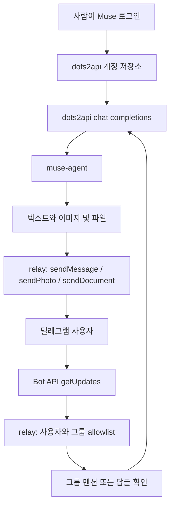

# 내 Muse 계정을 텔레그램 비서로 연결하기

[English](telegram-assistant-guide.md) | [설정·복구 레퍼런스](telegram.md)

이 가이드는 각자 소유한 Muse 계정과 텔레그램 봇으로 텍스트 대화와
응답 이미지·파일 전송을 연결합니다. 공개 relay의 실제 구현은
[`src/telegram/`](../src/telegram/)입니다. 계정 로그인은 사람이 직접 합니다.
다른 사람의 계정·봇·서버를 제공하는 서비스가 아닙니다.



## 1. 계정과 실행 환경 준비

- 본인이 로그인할 수 있는 Muse 계정, 텔레그램 계정과 새 봇이 필요합니다.
- 서비스 설치는 **Linux + 사용자 systemd** 전용입니다. Bun 1.3 이상,
  Muse용 Node.js 22 이상, Chromium, Xvfb가 필요합니다.
- 다른 OS에서는 저장소에서 수동 실행하는 경로를 사용합니다. 이 문서는
  Windows 서비스 설치나 Windows에서의 Muse 로그인 성공을 검증하지 않았습니다.
- 서버는 기본적으로 loopback에 바인딩합니다. 콘솔과 데이터 디렉터리를
  인터넷에 공개하지 말고 원격 접속에는 SSH 포트 포워딩을 사용하세요.

## 2. dots2api 설치

Linux에서 저장소를 받고 Muse 브라우저 의존성을 준비합니다.
다음 의존성 설치 예시는 Debian/Ubuntu용이며 다른 배포판은
[README의 Muse 연결 설명](../README.md#connect-a-muse-account)을 따르세요.

```bash
git clone https://github.com/sanguneo/dots2api.git
cd dots2api
bun install --frozen-lockfile
sudo apt install -y xvfb
bunx --no-install playwright install --with-deps chromium
bash install.sh --port 3010 --with-muse
```

설치 스크립트 자체는 root로 실행하지 않습니다. 프로그램은
`~/.local/share/dots2api/app`, 계정·키·이미지 등은
`~/.local/share/dots2api/data`에 분리해서 저장되고 `dots2api` 사용자 서비스가
시작됩니다. 로그아웃 후에도 서비스가 필요하면 관리자가
`sudo loginctl enable-linger "$USER"`를 한 번 실행합니다.
재설치는 프로그램을 갱신하고 서비스를 재시작하므로 작업이 없을 때 하세요.

수동 실행은 소스 저장소에서 `bun install --frozen-lockfile` 후
`bun run start`입니다. Muse의 브라우저·Node.js 의존성은 별도로 필요합니다.
수동 서버와 설치된 서비스를 같은 포트에서 동시에 실행하지 마세요.

원격 서버라면 자기 컴퓨터에서 실행합니다. `user@server`는 가짜 예시입니다.

```bash
ssh -N -L 3010:127.0.0.1:3010 user@server
```

브라우저에서 `http://127.0.0.1:3010`을 엽니다.

## 3. Muse 로그인과 gateway 키 준비

콘솔의 **Accounts → Add account → Muse**에서 계정 라벨을 정합니다.
열리는 원격 브라우저에서 사람이 직접 Google 로그인을 진행하고 필요한
인증을 마친 뒤 **로그인 완료 및 연결 확인**을 누릅니다. 기존 계정은
**Login → 원격 브라우저 시작**을 사용합니다. 로그인 자동화나 인증 우회는
이 흐름에 포함되지 않습니다.

콘솔의 계정 확인 결과를 보고 연결 상태를 확인합니다. **API guide**의
gateway 키는 아래의 비공개 `gateway-key.txt`에 직접 저장합니다.
쿠키·세션·키는 문서, Git, 채팅, 화면 캡처에 넣지 마세요.
이 가이드는 쿠키를 복사해 로그인하는 방법을 요구하지 않습니다.

## 4. BotFather와 privacy mode

텔레그램의 공식 **@BotFather**에서 `/newbot`을 실행하고 안내를 따릅니다.
발급된 토큰은 아래 `telegram-token.txt`에 직접 저장하세요.
봇 사용자명은 본인이 만든 실제 값을 사용합니다.

그룹에서 일반 `@사용자명` 멘션을 받으려면 BotFather의 `/setprivacy`에서
해당 봇을 선택하고 **Disable**로 설정한 뒤 그룹에 다시 추가합니다.
privacy mode를 유지하면 봇 메시지에 답글을 달거나 `/ask@사용자명 질문`처럼
봇을 지정한 명령을 사용하세요. relay에는 `/ask` 전용 명령 처리가 없으며
전달된 텍스트 전체를 모델로 보냅니다. 봇에 관리자 권한을 줄 필요는 없습니다.
privacy mode는 Telegram의 전달 범위이고, 아래 allowlist는 relay의 실행
권한이므로 둘을 따로 설정해야 합니다.

기존 webhook을 쓰던 봇은 먼저 해당 연동을 중지하고 Bot API의
`deleteWebhook`으로 webhook을 해제해야 합니다. 이 relay는 webhook을
자동으로 해제하지 않습니다. 같은 토큰으로 다른 `getUpdates` 수신기를
동시에 실행하지 마세요.

## 5. 비밀 파일과 명시적인 allowlist

Linux/POSIX 셸에서 비공개 디렉터리를 만듭니다.

```bash
umask 077
mkdir -p "$HOME/.config/dots2api-telegram"
chmod 700 "$HOME/.config/dots2api-telegram"
```

편집기로 `gateway-key.txt`와 `telegram-token.txt`를 이 디렉터리에 만들고,
각각 키 또는 토큰 하나만 저장합니다. 실제 값을 셸 명령에 붙이지 마세요.
두 파일을 만든 뒤 권한을 제한합니다.

```bash
chmod 600 "$HOME/.config/dots2api-telegram/gateway-key.txt" \
  "$HOME/.config/dots2api-telegram/telegram-token.txt"
```

사용자 ID는 `message.from.id`, 그룹 ID는 `message.chat.id`입니다.
표시 이름·전화번호·`@사용자명`으로 대체할 수 없습니다.
봇을 시작하기 전에 본인 봇에 DM을 보내고, 그룹에서도 봇 지정 명령을
보낸 뒤 로컬에서 Bot API `getUpdates`의 해당 필드를 확인하세요.
토큰은 파일에서 읽는 도구를 사용하고 응답 전체를 공유하지 마세요.
이 조회 중에는 relay와 다른 poller를 중지해야 합니다.
그룹을 supergroup으로 전환했다면 새 chat ID를 확인해야 합니다.

같은 디렉터리에 `telegram.json`을 만듭니다.
아래 숫자는 **가짜 값**이며 반드시 본인 사용자·그룹 ID로 교체하세요.
개인 DM만 쓸 때는 `allowedChatIds`를 명시적으로 `[]`로 둡니다.

```json
{
  "gateway": {
    "baseURL": "http://127.0.0.1:3010",
    "apiKey": { "file": "./gateway-key.txt" }
  },
  "telegram": {
    "botToken": { "file": "./telegram-token.txt" }
  },
  "allowedUserIds": [123456789],
  "allowedChatIds": [-1001234567890],
  "allowBotMessages": false,
  "model": "muse-agent",
  "systemPrompt": "You are a helpful assistant.",
  "stateDir": "./telegram-state",
  "requestTimeoutMs": 660000,
  "pollTimeoutSeconds": 25
}
```

`allowedUserIds`는 빈 배열을 허용하지 않습니다. DM은 허용된 사용자만,
그룹은 **허용된 사용자 AND 허용된 그룹 AND 봇 멘션 또는 봇 메시지에 답글**
일 때만 처리합니다. 익명 관리자·채널 명의 메시지는 받지 않습니다.
다른 봇은 기본적으로 무시합니다.

상대 경로는 현재 작업 폴더가 아니라 **설정 파일 옆**을 기준으로 합니다.
비밀 참조는 `{ "file": "..." }` 또는 `{ "env": "DOTS2API_API_KEY" }` 중
하나만 쓸 수 있습니다. systemd는 셸의 export를 상속하지 않으므로
이 예시는 파일을 사용합니다. 긴 Muse 응답을 위해 예시 타임아웃은
11분입니다. relay 기본값은 5분이며 실패 시 자동 재요청하지 않습니다.

## 6. relay 설치와 확인

Linux 서비스 설치는 설치된 프로그램 디렉터리에서 실행합니다.
설정·소스·Bun 경로에 공백, 따옴표, 역슬래시, `%`, `$`가 있으면
설치기가 거부합니다.

```bash
cd "$HOME/.local/share/dots2api/app"
bash install-telegram.sh --config "$HOME/.config/dots2api-telegram/telegram.json"
systemctl --user status dots2api-telegram
journalctl --user -u dots2api-telegram -n 50
```

`--no-start`를 추가하면 unit만 작성하며 시작·daemon-reload를 하지 않습니다.
그 뒤 시작하려면 `systemctl --user daemon-reload`와
`systemctl --user enable --now dots2api-telegram`을 실행합니다.

다른 OS 또는 수동 실행은 의존성을 설치한 **소스 저장소**에서 실행합니다.
아래는 POSIX 셸 예시이며 Windows 서비스 설정 예시가 아닙니다.

```bash
bun run telegram --config "$HOME/.config/dots2api-telegram/telegram.json"
```

수동 실행과 서비스를 동시에 켜지 마세요. 허용된 사용자로 DM에 짧은 텍스트를
보내 응답을 확인합니다. 이는 실제 Muse 요청입니다. 허용된 그룹에서는
봇 사용자명을 멘션하거나 봇 응답에 답글을 달아 확인합니다.
거부되는 사용자·그룹은 응답과 새 gateway 작업이 없어야 합니다.
로그에 인증값이 없는지도 로컬에서 확인하되 원본 로그를 공개하지 마세요.

## 7. 대화·링크·파일의 범위

- Muse 대화 키는 봇과 chat 단위입니다. 한 그룹의 사용자와 포럼 주제는
  같은 키를 공유하며 사용자별·포럼 주제별 분리가 아닙니다.
- `dots-agent`도 선택할 수 있지만 Dot의 주 대화를 사용하므로 이 키로
  채팅을 격리하지 않습니다. 독립적인 채팅에는 Muse를 사용하세요.
- 텍스트는 plain text로 나누어 전송합니다. 링크도 텍스트로 전달합니다.
- gateway의 같은 origin에 있는 `/api/jobs/.../images/...` 이미지와
  응답의 `[[file ...]]` 첨부 블록을 전송합니다. 임의의 외부 URL을
  파일로 다운로드하지 않습니다. 이미지 전송이 명확히 거절된 경우만
  문서 첨부로 바꿉니다.
- 입력 사진 분석은 지원하지 않으며 사진을 보지 못했다고 안내합니다.
  입력 문서·음성의 다운로드나 해석도 구현되어 있지 않습니다.

## 8. 재시작과 워치독

공개 설치기는 systemd의 `Restart=on-failure`, `RestartSec=10`을 사용합니다.
별도 `watch.sh`나 응답 지연을 감지하는 워치독은 포함하지 않습니다.
재시작해도 `pending`이나 남은 lock은 자동으로 해제하지 않습니다.

```bash
systemctl --user stop dots2api-telegram
# 진행 중 작업과 아래 복구 항목을 확인한 뒤
systemctl --user start dots2api-telegram
```

`stateDir`에는 수신 offset, bot ID, 불확실한 작업의 `pending` 기록과
`relay.lock`이 있습니다. 봇마다 하나의 상태 폴더를 유지하고 백업도
비공개로 보관하세요. 전체 상태를 지우면 중복 생성·전송이 생길 수 있습니다.

## 9. 문제 해결

| 증상/오류 | 확인과 조치 |
| --- | --- |
| `configuration` | JSON 필드, 비어 있지 않은 사용자 allowlist, 설정 기준 파일 경로와 권한, 키 파일 내용을 로컬에서 확인합니다. 비밀을 출력하지 않습니다. |
| DM 또는 그룹에 무응답 | 사용자 ID, 그룹 ID, 멘션/답글, BotFather privacy 설정, 그룹 재추가 여부를 확인합니다. 단순한 봇 별명은 호출 조건이 아닙니다. |
| `network` / `protocol` | gateway·Telegram 접근, 계정 연결 상태, 기존 webhook과 중복 poller를 확인합니다. 이 오류 코드는 구체적인 HTTP 원인을 노출하지 않습니다. |
| 긴 요청 뒤 중단 | relay 타임아웃과 gateway 작업 결과를 확인합니다. `pending`이면 아래 절차로 판단하며 같은 요청을 바로 다시 보내지 않습니다. |
| `locked` | 먼저 서비스와 수동 프로세스를 모두 확인합니다. 이전 프로세스가 종료된 경우에만 상태 폴더의 빈 `relay.lock` 디렉터리를 제거합니다. |
| `state` | 봇 토큰과 저장된 bot ID의 일치, 상태 파일 형식을 확인합니다. 다른 봇의 상태 폴더를 재사용하지 않습니다. |
| `pending` | 서비스를 멈추고 Telegram 응답과 gateway 작업 기록을 확인합니다. 상태를 비공개 백업한 뒤 처리 완료로 판단하면 `offset = pending.updateId + 1`, `pending = null`로 수정합니다. |
| `image` | 응답 이미지가 같은 gateway origin의 허용 경로인지, 키와 이미지 조회가 유효한지 확인합니다. 불확실한 전송은 반복하지 않습니다. |
| 서비스가 계속 실패 | `journalctl`과 `systemctl --user status`로 원인을 확인합니다. systemd 시작 제한에 걸렸다면 원인 해결 뒤 `systemctl --user reset-failed dots2api-telegram` 후 시작합니다. |
| Muse 로그인 화면이 열리지 않음 | Node.js 22+, Xvfb, Chromium 라이브러리와 서비스 PATH를 확인한 뒤 콘솔에서 사람이 다시 로그인합니다. |

`pending`을 지우되 offset을 올리지 않으면 해당 요청을 다시 실행할 수
있습니다. 원격 결과를 확인하고 의도적으로 재실행하기로 한 경우에만
선택하세요. 자동 재시도 스크립트로 이 보호 장치를 우회하지 마세요.

## 10. 선택 확장

공개 relay로 기본 연결을 먼저 확인하세요. 운영용 확장은 계정·정책에
맞춘 별도 설계가 필요하며 이 가이드는 코드를 이식하지 않습니다.

다음은 별도 운영 relay의 코드에 있는 구조와 공개본의 차이입니다.
운영 환경변수와 감시 스케줄은 확인하지 않았으므로 실제 활성화 상태를
보장하는 목록은 아닙니다.

| 기능 | 공개본 | 선택 확장의 구조 |
| --- | --- | --- |
| 그룹 호출 | 명시적인 사용자·그룹 allowlist와 멘션/답글 | 설정 가능한 별칭과 다른 봇 호출 제외 규칙. 공개본의 사용자 allowlist는 유지해야 합니다. |
| 깐깐한 응답 판정 | 없음 | relay 앞의 판정 단계가 그룹 맥락을 보고 응답 여부를 정합니다. 정해진 첫 줄 형식에 맞지 않거나 실패하면 침묵합니다. 외부 CLI·모델 의존성을 따로 관리해야 합니다. |
| 침묵과 진행 표시 | 없음 | 명시적인 침묵 신호, typing과 완료 표시를 수신·전송 상태와 연결합니다. |
| 워커 위임 | 없음 | 두뇌가 구조화된 작업 블록을 내고, 별도 Muse 스레드의 워커가 결과를 반환한 뒤 두뇌가 검산합니다. 동시 실행 제한, 종료 신호, 상태 저장, 재시작 복구와 스레드 정리가 필요합니다. |
| 워치독 | systemd 실패 재시작 | 서비스 상태·수신/완료 시각·오류 빈도를 감시하고 재시작 간격을 제한하는 별도 감시기입니다. 공개본의 pending 보호를 자동으로 풀어서는 안 됩니다. |
| 입력·링크·첨부 | 텍스트 입력과 응답 링크·이미지·파일 | 캡션·발신자·인용 맥락을 텍스트에 붙이고 출처 라벨을 정리할 수 있습니다. 사진을 실제로 읽는 기능과는 다릅니다. 공개본의 URL·MIME·파일 검증과 불확실한 전송의 재시도 금지는 유지합니다. |

작게 확장한다면 원래 메시지에 답장하기, 입력의 인용 맥락, 선택 가능한
호출 별칭부터 검토할 수 있습니다. 워커는 gateway의 스레드 삭제 API와
실패 처리 계약까지 함께 설계해야 합니다. 운영 전용 경로나 고정 ID,
개인 프롬프트를 복사하는 방식은 이 가이드의 설치 흐름에 포함하지 않습니다.

## 구현과 공식 참고

- [설정 스키마](../src/telegram/config.ts), [수신·전송·상태 처리](../src/telegram/relay.ts),
  [Linux 설치기](../install-telegram.sh), [예제 설정](../examples/telegram.json)
- [Telegram 봇 생성](https://core.telegram.org/bots/tutorial#obtain-your-bot-token)
- [Telegram privacy mode](https://core.telegram.org/bots/features#privacy-mode)
- [Bot API 수신 방식](https://core.telegram.org/bots/api#getting-updates)

이 저장소는 [yelixir-dev/dots2api](https://github.com/yelixir-dev/dots2api)를
바탕으로 합니다. 설치·clone 주소는 이 가이드가 설명하는
`sanguneo/dots2api`를 사용합니다.
