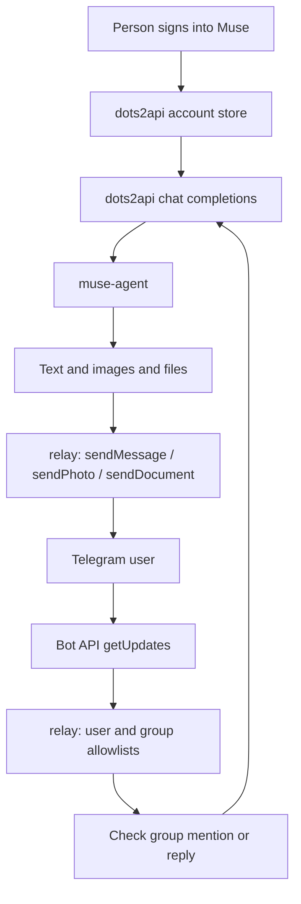

# Connect your own Muse account to a Telegram assistant

[한국어](telegram-assistant-guide.ko.md) | [Configuration and recovery reference](telegram.md)

Use your own Muse account and Telegram bot for text conversations and returned
images/files. The public implementation is in [`src/telegram/`](../src/telegram/).
A person signs in directly. This project does not supply someone else's account,
bot or hosted server.



## 1. Prepare accounts and a host

- Have a Muse account you can sign into, a Telegram account and a new bot.
- Service installation supports **Linux with user systemd**. You need Bun 1.3+,
  Node.js 22+ for Muse, Chromium and Xvfb.
- On other operating systems, use manual execution from the source checkout.
  This guide has not verified Windows service setup or Muse login on Windows.
- Keep the loopback console and data directory private. Use SSH forwarding to
  reach a remote console.

## 2. Install dots2api

On Linux, clone the repository and prepare Muse's browser dependencies.
These dependency commands target Debian/Ubuntu; for other distributions see
[Connect a Muse account in the README](../README.md#connect-a-muse-account).

```bash
git clone https://github.com/sanguneo/dots2api.git
cd dots2api
bun install --frozen-lockfile
sudo apt install -y xvfb
bunx --no-install playwright install --with-deps chromium
bash install.sh --port 3010 --with-muse
```

Run the installer as your own user. It stores the program in
`~/.local/share/dots2api/app`, keeps accounts, keys and images separately in
`~/.local/share/dots2api/data`, and starts the `dots2api` user service.
For operation after logout, an administrator can run
`sudo loginctl enable-linger "$USER"` once.
Reinstallation updates the program and restarts the service; wait for idle work.

For manual execution, run `bun install --frozen-lockfile` and `bun run start`
in the source checkout. Muse still needs its Node.js and browser dependencies.
Do not run a manual server and an installed service on the same port.

For a remote server, run this on your own computer. `user@server` is a placeholder.

```bash
ssh -N -L 3010:127.0.0.1:3010 user@server
```

Open `http://127.0.0.1:3010` in your browser.

## 3. Sign into Muse and prepare the gateway key

In **Accounts → Add account → Muse**, enter an account label. A person completes
Google login and any verification in the remote browser, then presses
**로그인 완료 및 연결 확인** (finish login and check connection).
For an existing account use **Login → 원격 브라우저 시작** (start remote browser).
This flow does not automate account login or bypass verification.

Check the account status in the console. Save the gateway key from **API guide**
directly into the private `gateway-key.txt` described below. Keep cookies,
sessions and keys out of documentation, Git, chat and screenshots.
This guide does not require copying login cookies.

## 4. BotFather and privacy mode

Contact the official **@BotFather**, send `/newbot`, and follow its instructions.
Save the issued token directly into `telegram-token.txt`. Use your bot's actual
username when addressing it.

For ordinary `@username` group mentions, use BotFather's `/setprivacy`, choose
the bot, select **Disable**, and re-add it to the group. With privacy enabled,
reply to a bot message or use a targeted command such as `/ask@username question`.
The relay passes that whole text to the model; it has no special `/ask` handler.
Admin rights are unnecessary. Telegram delivery privacy and relay authorization
are separate settings.

If this bot used a webhook, stop that integration and remove the webhook with
Bot API `deleteWebhook` first. The relay does not remove webhooks automatically.
Do not run another `getUpdates` receiver with the same token.

## 5. Private files and explicit allowlists

In a Linux/POSIX shell, create a private directory:

```bash
umask 077
mkdir -p "$HOME/.config/dots2api-telegram"
chmod 700 "$HOME/.config/dots2api-telegram"
```

Use an editor to create `gateway-key.txt` and `telegram-token.txt` there,
each containing only its respective secret. Do not paste secrets into commands.
After creating the files, restrict their permissions:

```bash
chmod 600 "$HOME/.config/dots2api-telegram/gateway-key.txt" \
  "$HOME/.config/dots2api-telegram/telegram-token.txt"
```

Your user ID is `message.from.id`; the group ID is `message.chat.id`.
Names, phone numbers and usernames are not substitutes. Before starting the bot,
send it a DM and a targeted command in your group, then inspect these fields
locally through Bot API `getUpdates`, using a tool that reads the token from its
file. Do not share full responses. Stop the relay and other pollers during this
lookup. A group converted to a supergroup needs its new chat ID.

Create `telegram.json` in the same directory. The numbers below are **fake**:
replace them with your own user and group IDs. For DMs only, explicitly set
`allowedChatIds` to `[]`.

```json
{
  "gateway": {
    "baseURL": "http://127.0.0.1:3010",
    "apiKey": { "file": "./gateway-key.txt" }
  },
  "telegram": {
    "botToken": { "file": "./telegram-token.txt" }
  },
  "allowedUserIds": [123456789],
  "allowedChatIds": [-1001234567890],
  "allowBotMessages": false,
  "model": "muse-agent",
  "systemPrompt": "You are a helpful assistant.",
  "stateDir": "./telegram-state",
  "requestTimeoutMs": 660000,
  "pollTimeoutSeconds": 25
}
```

`allowedUserIds` must not be empty. DMs require an allowed user. Groups require
**an allowed user AND an allowed group AND a bot mention or reply to the bot**.
Anonymous admin/channel sender messages are rejected. Other bots are ignored
by default.

Relative paths resolve **beside the config file**, not in the working directory.
Each secret accepts exactly one of `{ "file": "..." }` or
`{ "env": "DOTS2API_API_KEY" }`. User systemd services do not inherit shell exports,
so this example uses files. The example timeout is 11 minutes for long Muse
responses; the relay default is five minutes. Failed requests are not resubmitted
automatically.

## 6. Install and check the relay

Install the Linux service from the installed program directory. The installer
rejects source, config and Bun paths containing spaces, quotes, backslashes,
`%` or `$`.

```bash
cd "$HOME/.local/share/dots2api/app"
bash install-telegram.sh --config "$HOME/.config/dots2api-telegram/telegram.json"
systemctl --user status dots2api-telegram
journalctl --user -u dots2api-telegram -n 50
```

Add `--no-start` to write the unit without starting or reloading it. To start
later, run `systemctl --user daemon-reload`, then
`systemctl --user enable --now dots2api-telegram`.

For other operating systems or manual execution, run from the **source checkout**
after installing dependencies. This is a POSIX shell example, not Windows
service configuration:

```bash
bun run telegram --config "$HOME/.config/dots2api-telegram/telegram.json"
```

Run only one service or manual process. Send a short DM from an allowed user and
check the reply; this makes a real Muse request. In an allowed group, mention the
bot's username or reply to its message. Denied users/groups should receive no
reply and create no gateway job. Inspect logs locally for credential exposure;
do not publish raw logs.

## 7. Conversation, links and files

- Muse's conversation key is per bot/chat. Users and forum topics within one
  group share that key; there is no per-user or per-topic isolation.
- `dots-agent` is also available, but uses the primary Dot conversation without
  isolating chats through this key. Use Muse for independent chats.
- Replies are split into plain text messages. Links remain text.
- The relay sends same-origin gateway images at `/api/jobs/.../images/...` and
  response `[[file ...]]` attachment blocks. It does not download arbitrary
  external URLs as files. Only a definite photo rejection allows a document
  fallback.
- Incoming photo analysis is unsupported; the relay explicitly says it has not
  seen the photo. Incoming documents and audio are not downloaded or interpreted.

## 8. Restarts and watchdogs

The public installer uses systemd `Restart=on-failure` and `RestartSec=10`.
It includes no separate `watch.sh` or stalled-response watchdog. Restarting does
not automatically clear pending state or a leftover lock.

```bash
systemctl --user stop dots2api-telegram
# Check current work and the recovery steps below first.
systemctl --user start dots2api-telegram
```

`stateDir` contains the acknowledged offset, bot ID, uncertain-work `pending`
record, and `relay.lock`. Keep one state directory per bot and private backups.
Deleting all state can duplicate generation or delivery.

## 9. Troubleshooting

| Symptom/error | Check and action |
| --- | --- |
| `configuration` | Check JSON fields, a nonempty user allowlist, config-relative paths, permissions and secret-file contents locally without printing secrets. |
| No DM/group reply | Check user/chat IDs, mention/reply, BotFather privacy and group re-addition. A friendly bot nickname is not a trigger. |
| `network` / `protocol` | Check gateway/Telegram access, account status, old webhooks and competing pollers. These codes do not expose the specific HTTP cause. |
| Stops after a long request | Check timeout and gateway job results. Follow pending recovery before sending the same request again. |
| `locked` | Check both service and manual processes. Remove the empty `relay.lock` directory only after confirming the previous process is gone. |
| `state` | Check state format and that the token matches the saved bot ID. Do not reuse another bot's state directory. |
| `pending` | Stop the service and inspect Telegram and gateway job history. Back up state privately. If handled, set `offset = pending.updateId + 1` and `pending = null`. |
| `image` | Check the permitted same-origin gateway path, key and image availability. Do not repeat uncertain sends. |
| Service keeps failing | Inspect `journalctl` and `systemctl --user status`. After fixing the cause of a systemd start limit, run `systemctl --user reset-failed dots2api-telegram` and start it. |
| Muse login viewer does not open | Check Node.js 22+, Xvfb, Chromium libraries and service PATH, then have a person sign in again through the console. |

Clearing `pending` without advancing the offset permits that update to run again.
Choose this only after inspecting the remote outcome and deliberately deciding to
resubmit. Do not bypass this protection with an automatic retry script.

## 10. Optional extensions

Establish the basic connection with the public relay first. Operational
extensions need a separate design for your own account and policies; this guide
does not port their code.

These structures exist in a separate operational relay's code. Its environment
variables and watchdog schedule were not inspected, so this does not assert
that every feature is currently active.

| Feature | Public relay | Optional extension structure |
| --- | --- | --- |
| Group triggers | Explicit user/chat allowlists and mention/reply | Configurable aliases and exclusion of calls to other bots. Preserve the public user allowlist. |
| Strict response decision | None | A front stage considers group context and decides whether to answer. Unexpected first-line formats or failures result in silence. External CLI/model dependencies need separate management. |
| Silence and progress | None | Connect an explicit silence signal, typing and completion indicators to receive/send state. |
| Worker delegation | None | The main assistant emits a structured task block; a worker in a separate Muse thread returns a result for the main assistant to review. This needs concurrency limits, terminal signals, persistent state, restart recovery and thread cleanup. |
| Watchdog | systemd failure restart | A separate watcher checks service status, receive/completion times and error frequency, with restart cooldowns. Never clear the public relay's pending protection automatically. |
| Input, links and attachments | Text input and returned links/images/files | Include captions, sender and quoted context as text, and clean trailing source labels. This does not mean seeing an attached photo. Preserve public URL/MIME/file validation and the prohibition on retrying uncertain sends. |

For smaller extensions, consider replying to the original message, quoted input
context and configurable aliases first. Workers also need a design against the
gateway's thread deletion API and failure contracts. Copying private paths,
fixed IDs or personal prompts is outside this installation flow.

## Implementation and official references

- [Config schema](../src/telegram/config.ts), [polling, sending and state](../src/telegram/relay.ts),
  [Linux installer](../install-telegram.sh), [sample config](../examples/telegram.json)
- [Telegram bot creation](https://core.telegram.org/bots/tutorial#obtain-your-bot-token)
- [Telegram privacy mode](https://core.telegram.org/bots/features#privacy-mode)
- [Bot API update delivery](https://core.telegram.org/bots/api#getting-updates)

This repository builds on [yelixir-dev/dots2api](https://github.com/yelixir-dev/dots2api).
Use `sanguneo/dots2api` for the clone/install instructions in this guide.
